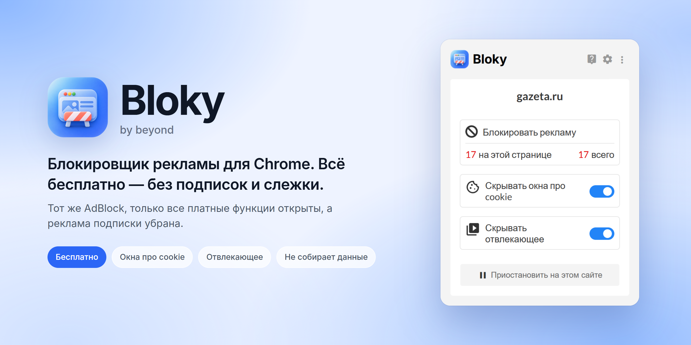

# Bloky

Блокировщик рекламы для Chrome. Бесплатно, без подписок и без слежки.

## ✨ Особенности

- Это тот же **AdBlock**, только все платные функции открыты — здесь всё бесплатно
- Никакой рекламы подписки, всплывающих предложений и «попробуйте Premium»
- Не собирает данные и не отправляет статистику
- «Ненавязчивая реклама» выключена (включить можно в настройках)
- Скрывает рекламу, трекеры, окна про cookie и всплывающие окна
- Списки рекламы обновляются сами

## 📥 Установка

**[Установить из Интернет-магазина Chrome](https://chromewebstore.google.com/detail/dkigkhgefgnkcdgdaahfljjmfgagalmi)** — обновления будут приходить сами.

**Или вручную:**

1. Скачайте **`bloky-chrome-….zip`** из [последнего релиза](https://github.com/stylist111/bloky/releases/latest) и распакуйте в отдельную папку.
2. В Chrome: **⋮ → Расширения → Управление расширениями** → включите **Режим разработчика**.
3. **Загрузить распакованное расширение** → выберите эту папку.

Другой блокировщик рекламы лучше выключить — два сразу мешают друг другу.

## 💬 Нашли проблему?

[Напишите](https://github.com/stylist111/bloky/issues) и приложите адрес страницы.

---

Сделан на основе открытого кода [AdBlock](https://gitlab.com/eyeo/browser-extensions-and-premium/extensions/extensions) (лицензия GPLv3), с AdBlock и eyeo не связан. [Политика конфиденциальности](PRIVACY.md) · [Сборка из исходников](docs/BUILD.md)
