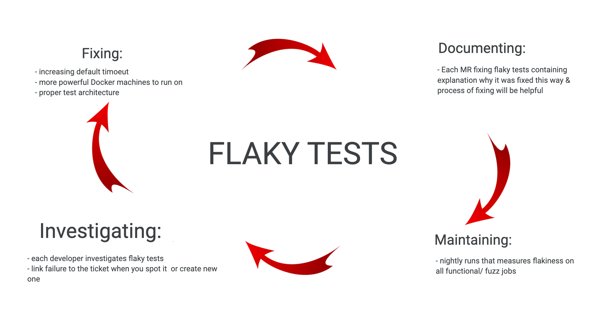

# eyeo's WebExtension Ad-Filtering Solution Testing

This project is automatically tested by unit, functional, integration and
performance tests:

- Unit tests check isolated functions at code level.
- Functional tests cover most of the functionality and run in a browser
environment.
- Integration tests check that the SDK integrates smoothly from an extension
  developer point of view.
- Performance tests check that SDK performance metrics do not degrade.

All test kinds run on the CI pipeline. They can also be executed on a local
development environment.

## Pipelines structure

The CI pipeline has the following stages:

- Build - stage where webextension-sdk is built, and tested statically by audit
and linting.
- [Unit](#unit-tests) - unit tests for both adblockpluscore & webext-sdk.
- [Functional tests](#functional-tests) - most extensive tests. It contains
functional tests on web bundles, scripts and functional tests on various
combinations of browsers and manifests. Note: the set of browsers varies for the
main branch.
- [Fuzz Functional tests](#fuzz-functional-tests) - MV3 related service workers
tests based on functional suite. Runs a subset of the functional tests, while
suspending the service worker regularly to determine how the system behaves.
- [Compliance tests](#compliance-tests) - tests ensuring compliance between
eyeo's adBlocking products.
- [Integration tests](#integration-tests) - tests of the integration scripts.
- [Performance tests](#performance-tests) - measure the performance of the
engine.

## Unit Tests

### Run all tests

The following suites run all together with `npm test`:

- Adblockpluscore unit tests
- Webext unit tests
- Scripts tests

Please notice the adblockpluscore browser tests run separately. For details please
see the following sections.

### Adblockpluscore

The engine contains a adblockpluscore repository responsible for
the adblockpluscore ad-filtering logic, which is tested at unit and browser levels.
To run all adblockpluscore tests use the following commands from the top level
directory:

```
npm run -w adblockpluscore test:unit
npm run -w adblockpluscore test:browser
```

Optionaly use a test path to run a single unit test module. Example:

```
npm run -w adblockpluscore test:unit -- test/dnr.js
```

### Unit (webext)

In webext we mostly use functional tests to make sure everything works.

Additionally, two specific areas lend themselves to unit tests.

1. For utilities in the `src/all` folder. These may be individual imported by
   users of the SDK, and should not depend on any browser-specific APIs, and so
   are good candidates for unit testing. These unit tests go in the
   `test/unit/all` folder.
2. When background API functionality gets complicated and when testing some
   specific state of the system is required. These unit tests go in
   `test/unit/background`, and mock browser API. On a high level all our tests
   and production code uses `browser.js`, which will either be the actual
   webextension polyfill or our unit tests mock based on our webpack config.

To run the webext unit tests use the following command:

```
npm run -w @eyeo/webext-ad-filtering-solution test:unit
```

#### Mocking browser APIs

The mocked files used by the background unit tests are automatically generated
with `mock(...)`  and `cachedMock(...)` functions. It is also possible to
generate mocked files by passing the filename from the `/src/background/`
directory:

```
cd core/sdk/
npx webpack --config ./test/unit/background/mock/webpack.config.js --env filename="subscriptions.js"
```

### Scripts

To be able to use webext in extension integrator has to generate files
(containing f.ex subscriptions) using our scripts. To test if scripts work
properly use following command:

```
npm run -w @eyeo/webext-ad-filtering-solution test:scripts
```

## Functional tests

Next stage of testing focuses on the software’s reactions to various activities
rather than on the mechanisms behind these reactions.

### Run All Tests

```
npm run -w @eyeo/webext-ad-filtering-solution build-then-test -- {2|3} {chromium|firefox|edge}
```

This script runs the test server and the test suite. You can also run each of
these independentally using:

```
npm run -w @eyeo/webext-ad-filtering-solution build
npm run -w @eyeo/webext-ad-filtering-solution test:functional -- {2|3} {chromium|firefox|edge}
```

In order to pass additional arguments, use the following syntax:

```
npm run -w @eyeo/webext-ad-filtering-solution build-then-test -- {2|3} {chromium|firefox|edge} --argName="{ARGUMENT}"
```

For example:

```
npm run -w @eyeo/webext-ad-filtering-solution build-then-test -- 3 chromium --grep="Test Name"
```

### Func:bundle

Checks that the bundled code can be imported and re-bundled:

```
npm run -w @eyeo/webext-ad-filtering-solution test:bundle
```

### Functional tests on browsers

Most exhaustive tests on our pipeline testing webext-sdk integrated into
test-extension and by visiting various web pages (served by test-server).

Important: All linux tests are run on Docker, all Windows tests are run on
[Windows shared runners](https://docs.gitlab.com/ee/ci/runners/hosted_runners/windows.html)
on a pipeline.

For Chromium-based browsers a DNS mapping entry (webext.com, sub.webext.com, search.webext.com
and webext.co.uk to 127.0.0.1) is added to browser configuration for domains testing.

#### Serving the test pages on test-server

Regardless of whether you're manually loading the test extension, or using the
test runner, functional test suites require locally served test pages.
When running tests on Docker, the test-server is run automatically on Docker
container, no need to run it locally.

```
npm run -w @eyeo/test-utils start-sdk-server
```

#### Using the test extension

The test extension containing webext-sdk will be built on both `/dist/test-mv2`
and `/dist/test-mv3` folders, which can be loaded as unpacked extensions under
`chrome://extensions` in Chromium-based browsers, and under `about:debugging` in
Firefox. Once the extension is loaded, it opens the test suite in a new tab.

Notes:

- test-mv2 contains a manifest version 2 extension, and test-mv3 contains a
manifest version 3 extension.
- For the popup tests to work, you have to disable the browser's built-in popup
blocking (on localhost).

You can also inspect the extension's background page to manually test the API
through the global EWE object.

Please refer to [Test Options](#test-options) for more details about options you
can use on UI.

#### Using the test runner

For local runs you can trigger test runner to run tests you desire:

```
npm run -w @eyeo/webext-ad-filtering-solution test:functional -- {2|3} {chromium|firefox|edge} [version|channel] [options]
```

Runner options need to be preceded by two dashes (`--`), for example
`--timeout 10000`.

Screenshots for test runner commands that failed (i.e. `driver.findElement(...)`)
are stored in `host/core/sdk/test/screenshots`. Please notice that doesn't
include functional tests failures, which run embedded in the test extension.

#### Test options

- The `timeout` option overrides the per-test timeout in milliseconds.
- The `grep` option filters the tests to run with a regular expression.
- The `incognito` checkbox is used to inform the tests whether the browser
started in incognito/private mode or not. This does not cause tests to run in
incognito mode.
- The `forceHeadful` checkbox is used to inform the tests whether the browser
started in headless mode or not. By default tests are run in headless mode for
Firefox and Chrome >111.
- The `testKinds` option is used to run only a certain subset of the functional
tests. For example, you can target only the service worker fuzzing tests by
running `--testKinds fuzz`, or a combination of the functional, reload and
update tests by running tests with
`--testKinds functional reload update mv2-mv3-migrate`.
- The `browserBinary` option allow to pass installed browser binary
to use custom versions. For example:
`npm run -w @eyeo/webext-ad-filtering-solution test:functional 3 chromium -- --browserBinary="/Users/user/Documents/repo/webext-sdk/browser-snapshots/chromium/chromium-darwin-x64-1097561/chrome-mac/Chromium.app/Contents/MacOS/Chromium"`
- The `verbose` option prints local test servers (admin and pages) requests

#### Web bundle regeneration

The tests for the web bundle blocking require a .wbn file. The one currently
used is provided in the tree. However, if it needs to be regenerated, there is
`test/tools/webbundle-builder.js` to be run from the SDK root. The content is
fixed in the script, so simply re-running it shouldn't yield any difference.
It relies on the wbn module that will be installed as a development dependency.

### Tagging functional tests

Tags can be added to a test or a suite of tests to modify when the tests are
run and when they are skipped.

A tag is kebab-case identifier inside square brackets, for example `[mv2-only]`.

For example, a test which is tagged to run only in MV2 mode would be tagged like
so:

```js
it("logs blocking $header filter [mv2-only]", async function() {
  // test body here
});
```

Tags can also be added to `describe` descriptions to tag entire suites.

If multiple tags are applied to the same test, all are applied.

#### The tags and their functionality

- `[mv2-only]`: Only run this test when testing an MV2 extension.
- `[mv3-only]`: Only run this test when testing an MV3 extension.
- `[runner-only]`: Only run this test when the test is run using Selenium
  Webdriver (ie it is launched from the console using
  `npm run -w @eyeo/webext-ad-filtering-solution test:functional` script).
- `[flaky]`: Run this test when using the `ONLY_FLAKY="true"` option in the
  functional test docker container.
- `[fuzz]`: Run this test in the service worker fuzz tests. By default, tests
  are not run in the service worker fuzz tests, so only the subset selected with
  `[fuzz]` and `[fuzz-only]` are run.
- `[fuzz-only]`: Only run this test in the service worker fuzz tests.

All `-only` tags have an equivalent `-skip` tag, which does the opposite. For
example, a test tagged with `[mv2-skip]` will only be run when NOT testing an
MV2 extension.

## Fuzz Functional tests

One of the major changes that Google has introduced in Chrome with the Manifest
V3 browser extension API is background service workers. These replace background
pages as the only way to have an extension running a script in the background.

For the most part, this is fine. You can do most of the things we needed to do
in a background page in the new service worker.

However, there is one major difference: service workers are event driven and may
be suspended by the browser at any time the browser decides they are not in
use. From a testing perspective, this means that we need to test that our
functionality works even when it is triggered while the service worker is
currently suspended.

Rather than writing a whole separate suite of tests for this, we instead rerun a
subset of the functional tests, except before any interaction with the service
worker the service worker is suspended. These are referred to as the Fuzz tests.

### Tagging which tests should run as fuzz tests

We avoid running all of the functional tests in fuzz mode because suspending the
service worker is a slow process. This makes the fuzz tests take a long time.

We aim to run a representative subset of the functional tests based on the
impact of service workers. As a rule of thumb, include one "happy path" for each
distinct piece of functionality. For example, enable one fuzz test for adding a
filter, but then don't enable the tests for adding multiple filters at once or
any of the filter validation cases since they don't add any extra requirements
for the service worker to start up correctly.

Only the functional tests with the `[fuzz]` or `[fuzz-only]` tags in their
description are run during the fuzz tests.

Untagged tests are not run, but it is generally expected that they would pass if
they were enabled in the future.

The `[fuzz-skip]` tag can be applied to tests which are not expected to pass if
the service worker is suspended as part of running the test.

## Compliance tests

Compliance tests are performed on a local version of [testpages](https://abptestpages.org)
to assure compliance between webext and other eyeo adblocking solutions. They
run the automated tests developed on the testpages project using the engine test
extension. Snippets and Subscriptions tests are skipped due to extension
limitations.

## Integration tests

Integration tests checks if from integrator perspective (and directory)
everything will work fine. To run integration tests locally use the following
command:

```
./core/sdk/test/dockerfiles/integration-entrypoint.sh
```

## Performance tests

The performance of the engine is measured using
[lightnouse metrics](https://developer.chrome.com/docs/lighthouse/performance/performance-scoring#metrics).

To run the performance tests:

```shell
npm run -w @eyeo/webext-ad-filtering-solution test:performance -- {2|3} {chromium|edge} [--forceHeadful] [--slow] [--saveBaseline]
```

The `slow` option (MV3 only) uses a slow performance extension, which contains
modified content scripts code that has a negative impact on the EWE performance.
Lighthouse tests are expected to fail when that option is used.

The `saveBaseline` option runs lighthouse several times per URL and saves the
baseline file, which is the file used by the performance checks to decide if a
certain metric is higher than the expected performance.

Notes:

- Firefox is not supported by the performance tests.
- Performance checks are skipped when the `saveBaseline` option is used.

### Lighthouse checks math

To decide whether a metric value is within the expected performance or not,
the actual value obtained with lighthouse is checked against a baseline file,
which contains median and maximum values per metric per URL.

Here's how the maximum allowed value is obtained, depending on the type of
metric:

- Factor metrics: `maximum_allowed_value = baseline_median * factor`. Each URL
has its own hardcoded factor, depending on the nature of the URL.
- Scaling metrics: `maximum_allowed_value = scaling(baseline_median)`. Those
metrics tend to need a higher allowance, therefore a scaling function with
[exponential decay](https://en.wikipedia.org/wiki/Exponential_decay) is used.
- Health metrics: `maximum_allowed_value = baseline_max * factor`. Used to
decide if the lightouse results are relevant. When they are not, metrics checks
on that URL will be skipped.

URL factors and scaling constants have been adjusted by running the tests
multiple times.

## Docker local runs

### Using the test runner on docker

The CI/CD pipeline runs the tests using this docker image. Using docker locally
to run the same tests may be useful to recreate the infrastructure the CI uses.

Note: Any `docker build` commands listed here expect that the SDK has already
been built into `./core/sdk/dist`.

#### Func:webext

```
npm run -w @eyeo/webext-ad-filtering-solution build
docker build -t functional -f core/sdk/test/dockerfiles/functional.Dockerfile .
docker run --shm-size=2g -it -e TEST_PARAMS="{2|3} {chromium|firefox|edge}" functional
```

Please notice that the TEST_PARAMS argument can also take the additional options
described previously.

To access the screenshots for test runner commands that failed, run the following
command, which copies them to the `host/core/sdk/test/screenshots` folder:

```
docker cp $(docker ps -aqf ancestor=functional | head -n 1):/extensions/host/core/sdk/test/screenshots ./host/core/sdk/test
```

#### Compliance

```
MANIFEST={mv2|mv3} ./core/sdk/test/scripts/compliance.sh
```

Optional environment variables for the script:

- TESTS_TO_INCLUDE
- BROWSER
- VERSION

#### Performance

```shell
docker run --shm-size=2g -it -e NODE_OPTIONS="--max-old-space-size=4096" --entrypoint npm functional run -w @eyeo/webext-ad-filtering-solution test:performance -- {2|3} {chromium|edge} [--slow] [--saveBaseline]
```

In order to access the screenshots for failing tests run the following command,
which copies the screenshots to the `<destination>` folder:

```shell
docker cp $(docker ps -aqf ancestor=functional | head -n 1):/extensions/core/sdk/test/screenshots <destination>
```

When the `saveBaseline` option is used, please use the following command to
replace the local baseline docker file with the one generated in the docker
container:

```shell
docker cp $(docker ps -aqf ancestor=functional | head -n 1):/extensions/core/sdk/test/performance/baseline_docker.json ./core/sdk/test/performance/baseline_docker.json
```

On the CI, setting the `SAVE_BASELINE` pipeline variable to `true` will trigger
the `perf:save-baseline:v3:chromium` job.

#### ARM architecture (M1/M2 Apple Silicon)

The previous examples assume an Intel/AMD architecture on the running machine.
On ARM architectures, the run is done emulating the AMD architecture.
Requirements:

- macOS >= 13 (Ventura)
- Rosetta

The `--platform` option should be used when running the image. Example:

```
docker run --platform linux/amd64 ...
```

### Maintaining browser cache

If you plan to work on one image by rerunning tests (f.ex to investigate
flakiness) you can download it to the docker image and cache it. To do so please
add the `BROWSER` argument to the build command as follow:

```
docker build -t functional -f core/sdk/test/dockerfiles/functional.Dockerfile --build-arg BROWSER=<chromium> .
```

For linux machines only: If you have a slow internet connection or are running
the test many times, you can add the following flags to docker run to use the
browser download cache from the host machine:

```
-v $(pwd)/browser-snapshots:/extensions/core/sdk/browser-snapshots
```

## Flaky Tests

Flaky tests in our CI pipelines are annoying because they don't fail or succeed
every time. We’ve implemented process for reducing flakiness:

Currently our pipelines are not flaky and if any flaky test is spotted by a
developer, a high priority ticket should be immediately created.



### Investigating/fixing functional flaky tests

The best way of investigating flaky tests locally is using docker (instead of
`npm -w @eyeo/webext-ad-filtering-solution test:functional`).

If you need to run specific tests to investigate/reproduce
flakiness, use the `[flaky]` tag in the name of the test, along with the
`ONLY_FLAKY` parameter set to `true`. Example:

```
docker run ... -e ONLY_FLAKY=true functional
```

### Tips for debugging failing/ flaky tests

If job is failing on the pipeline but works on docker on your machine check first
if you test on:

- same browser & same browser version,
- same manifest version,
- you rebuild docker image,
- you use same operating system or VM or container,
- you use same set of tests (running isolated tests might behave differently).

If you still experience failing tests on pipelines while you have tests passing
locally on Docker. You can try to raise shared runner resources by adding tag
to the job that is failing:

```

func:v2:chromium:latest:
  tags: [ saas-linux-large-amd64 ]

```

This way you can check if there might be wrong architecture of the tests (race conditions
static timeouts, etc).

If tests are failing due to timeouts (of the tests or `wait()`), add `console.log()`
in each step of the test to see where test starts to "hang" and investigate
this step.

#### Code tracing to analyze flaky tests reasons

Import `info()`, `log()`, `warn()`, `error()` or `trace()` from
`src/background/debugging.js` to record that is happening in the solution and
make it printed in the console when a test fails:

```
import {trace} from "./debugging.js";
...
function onBeforeNavigate(details) {
  trace({details});
...
```

Use callback to avoid logging performance penalty if having no `EWE.debugging.onLogEvent`
listeners:

```
...
debug(() => `Some message with a long ${variable} that takes too much of CPU and memory`));
...
```

By default debug output is enabled in test web extension and it can be changed with
`EWE.testing.enableDebugOutput()` call.

### Checking your tests quality on a pipeline

If you need to debug specific flaky tests on the pipeline, add [flaky] to the
tests you want to run & then add `[flaky]` to the commit message.
This will trigger pipeline that will run only tests marked flaky in tests.

You can also use UI to trigger "check tests quality jobs" on the branch you
are working on.
This will trigger "measure flakiness" scripts & check that will run
test modules in isolation:

- Go to: <https://gitlab.com/eyeo/browser-extensions-and-premium/extensions/extensions/-/pipelines>
then click "New pipeline” on the top right.
- Select branch you want to run pipeline on
- Provide variable key : `NIGHTLY_RUN`, value: `true`
- Run pipeline by clicking "New pipeline" button

Note: this setup is run on main on our Nightly Runs - checking if our
tests are good quality (not flaky and independent from each other).

### Functional Isolated Tests

Isolated tests run the tests one-by-one, which prevents them potentially intefering
with each other if they are run concurrently.

To run test suites locally in isolation, run the following docker commands:

```
docker run --shm-size=2g -it -e TEST_SUITES="suite_1 suite_2" -e TEST_PARAMS="v3 chromium" --entrypoint core/sdk/test/dockerfiles/isolated-entrypoint.sh functional
```
