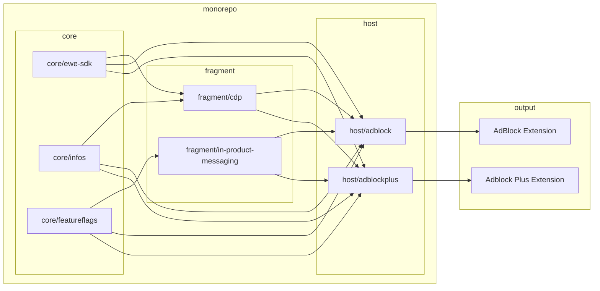

# The Monorepo Architecture

## Main architectural components

There are four main types of architectural components:

- [Core utilities](#core-utilities)
- [Extension fragments](#extension-fragment)
- [Host extensions](#host-extension)
- [Tools](#tools)

The diagram below illustrates the interactions between the different types of
components:

### Core utilities

Core functionality that any extension fragment can rely on. They help to
establish consistency in practices, discourage usage of unsafe APIs, and reduce
duplication.

Examples: feature flags, APIs to obtain browser and extension information.

[Read more](./core/sdk/README.md).

### Extension fragment

Encapsulation of business logic and functionality, to enable modular development
and easy maintenance within the broader extension ecosystem.

A fragment is an NPM package that can be imported into an extension, which may
contain code that runs in the background, content-scripts, UI Fragments, UI
logic, etc; but it is not an extension on its own.

The package does not need to be published to an NPM repository, it can simply be
imported locally within the monorepository.

A fragment can be able to run in a standalone manner, outside a host extension
but that is irrelevant for integration purposes.

Examples: Readership Link, In-product messaging (IPM).

[Read more](./fragment/README.md).

### Host extension

The extension that composes core packages and extension fragments together. What
we ship to the stores.

Examples: AdBlock, Adblock Plus.

[Read more](./host/README.md).

### Tools

Utilities used throughout the Extensions repository

Examples: Common test runner, release scripts, repository importing.

[Read more](./tools/README.md).

## Extension execution contexts

There are generally four distinct types of environments that extension code can run in, based on its access to privileged APIs. Generally, the more access a context has, the more isolated it is from web pages.

- [Background process](#background-process) (= "background")\
  _This is either a background page (Manifest v2) or a service worker (Manifest v3)._
- [Web content frame](#web-content-frame)
  - Isolated world (= "content")
  - Main world (= "main")
- [UI page](#ui-page) or [developer tools window](#developer-tools-window) (= "ui")

In addition to that, there are also some special cases:

- "all": Functionality that can be used in any context except a Main world.
- "content-ui": UI page that is injected into the Main world.
- "front": Functionality that is only meant to be used in UI pages and Isolated worlds.
- "shared": Deprecated alias for "all".

In order to ensure the integrity of those contexts, any imported modules should come from a compatible context.

### Background process

Each extension has a single background process. Scripts running in this process have access to privileged extension APIs based on the permissions the user has granted the extension.

### Developer tools window

Each developer tools window can run a script to manage the host's developer tools panels.

### Web content frame

Each browser tab contains one or more frames that can run content scripts from the host.

#### Isolated world

Extensions can run their scripts in the isolated world, where they are given their own JavaScript execution context but with access to the frame's DOM.

Despite this separation, scripts should be considered untrusted, as they run in the same process as scripts in the main world. Additionally, any interactions with the DOM may be detectable by other scripts on the web page, and any modifications it makes to the DOM may remain when the extension gets unloaded and should therefore be cleaned up.

#### Main world

The main world is where the web page's own scripts are running.

Extensions can run their scripts in the main world, where they share the same JavaScript execution context and DOM as any other scripts on the web page. They are functionally equivalent to any other scripts that run in that same web content frame.

Therefore extra care is needed to ensure safe communication with other extension contexts to avoid compromises of any privileged context.

### UI page

Each extension can include HTML pages. Scripts running in the context of a UI page have access to privileged extension APIs based on the permissions the user has granted the extension.
