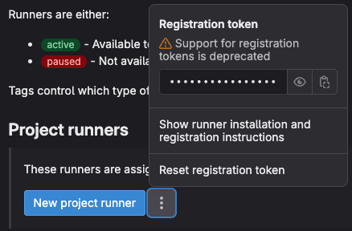

# Gitlab runners

This document shows how CI jobs can run in a [Gitlab runner](https://docs.gitlab.com/runner/)
set up on a private machine, as an alternative to the SaaS runners hosted by
GitLab.

Gitlab runners can run at OS level or in a Docker container. This document only
covers the Docker run.

## Local run

Setting up Gitlab runners locally allows jobs from the CI pipeline to run on a
local machine.

### Registering a runner

1. Get a registration token from the Runners section in the 
[CI/CD settings](https://gitlab.com/eyeo/adblockplus/abc/webext-ad-filtering-solution/-/settings/ci_cd):



Please make sure that you click the three vertical dots button, not the "New
project runner" blue button.

Note: Registration tokens are deprecated. [Authentication tokens](https://docs.gitlab.com/ee/ci/runners/runners_scope.html#create-a-project-runner-with-a-runner-authentication-token)
should be the standard approach, but that currently [doesn't work](https://gitlab.com/gitlab-org/gitlab/-/issues/424239).

2. Register a docker runner using the `TOKEN` from the previous step. Example:

```sh
docker run --rm -it -v /srv/gitlab-runner/config:/etc/gitlab-runner gitlab/gitlab-runner register \
  --url "https://gitlab.com/" --registration-token <TOKEN> \
  --executor docker --docker-image "node:18-bullseye-slim" \
  --description "local test" --tag-list "local-test"
```

Press enter to accept all default options. A `config.toml` file should have been
created (or updated) in the `/srv/gitlab-runner/config` folder.

Refresh the CI/CD runners page to check that the registered runner appears
there.

It's important that the tags in `--tag-list` are different from the already
existing project runners, otherwise the CI job may run on someone else's
machine.

Editing `config.toml` can change default values, for instance the maximum amount
of concurrent jobs in the runner process. For details, please check the
[config.toml reference](https://docs.gitlab.com/runner/configuration/advanced-configuration.html).

Notes:

- On macOS, `/srv` needs to be changed to `/Users/Shared`. The same applies
to the commands below.
- On Apple Silicon architectures, the `--platform linux/amd64` option should
be added.
- These notes apply to the next steps as well.

3. Register a docker-in-docker (dind) runner:

```sh
docker run --rm -it -v /srv/gitlab-runner/config:/etc/gitlab-runner gitlab/gitlab-runner register \
  --url "https://gitlab.com/" --registration-token <TOKEN> \
  --executor docker --docker-image "docker:24.0.5" --docker-privileged --docker-volumes "/certs/client" \
  --description "local test dind" --tag-list "local-test-dind"
```

4. Start the runner process:

```sh
docker run -it -v /srv/gitlab-runner/config:/etc/gitlab-runner \
  -v /var/run/docker.sock:/var/run/docker.sock gitlab/gitlab-runner
```

### Running CI jobs locally

1. Add tags to `.gitlab-ci.yml`:

By default, the jobs defined in `.gitlab-ci.yml` run on SaaS runners hosted by
Gitlab. Adding `tags` to any job will make it run on any registered runner with
such tags. Example:

```yaml
build:
  ...
  tags:
    - local-test

func:v3:chromium:stable:
  ...
  tags:
    - local-test-dind
```

2. Trigger the CI pipeline.

The tagged jobs should now run on the local machine.

### Debugging a local runner

#### docker exec

`docker exec` can be used to run any command into a running container.

Now, the containers where CI jobs run get automatically deleted after the job has
finished running. Gitlab has an [open issue to improve that behaviour](https://gitlab.com/gitlab-org/gitlab-runner/-/issues/3605).

To artificially keep the container running, `sleep` can be used as the last
script command. Example:

```yaml
func:v3:chromium:stable:
  ...
  script:
    - docker build -t functional-local -f test/dockerfiles/functional.Dockerfile --build-arg BROWSER="$BROWSER" --build-arg SKIP_BUILD=1 .;
    - sleep 600
  tags:
    - local-test-dind
```

Once the job is triggered we want to get the corresponding container id:

```sh
docker ps

CONTAINER ID   IMAGE                  COMMAND                  CREATED             STATUS             PORTS           NAMES
3178d4d6fad9   2b564bb4cc4b           "dockerd-entrypoint.…"   33 seconds ago      Up 32 seconds      2375-2376/tcp   runner-zegkjgxu-project-22365241-concurrent-0-a8b0105dc4903063-build
a76adec7b47f   2b564bb4cc4b           "dockerd-entrypoint.…"   43 seconds ago      Up 42 seconds      2375-2376/tcp   runner-zegkjgxu-project-22365241-concurrent-0-a8b0105dc4903063-docker-0
75b666c6ab7e   gitlab/gitlab-runner   "/usr/bin/dumb-init …"   About an hour ago   Up About an hour                   gifted_leakey
```

We need the id of the container named `...-docker-0` to execute commands:

```sh
docker exec -it <CONTAINER ID> <COMMAND>
```

For instance, we could run `docker run` inside that container:

```sh
docker exec -it a76adec7b47f docker run -e TEST_PARAMS="v3 chromium --testKinds reload" functional-local
```

#### Interactive web terminal

Gitlab offers [interactive web terminals](https://docs.gitlab.com/ee/ci/interactive_web_terminal/).
Potentially, any machine hosting self-managed runners could be configured to
allow that service. That needs further investigation.
