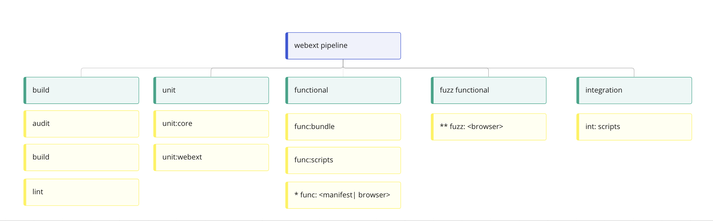
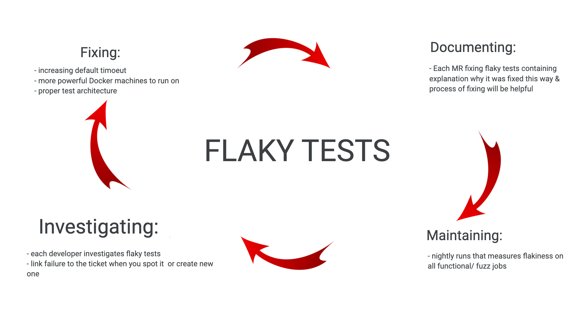
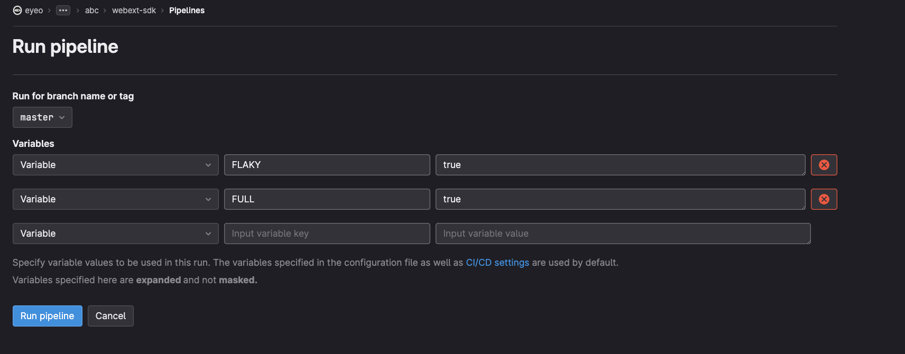

# eyeo's Web Extension Ad Blocking Toolkit Testing

This project is automatically tested by functional, unit and integration tests:

- Functional tests cover most of the functionality and run in a browser
environment.
- Unit tests check isolated functions at code level.
- Integration tests check that the SDK integrates smoothly from an extension
  developer point of view.

All test kinds run on the CI pipeline. They can also be executed on a
development local environment.

## Pipelines structure

Pipeline has 6 stages:

- Build - stage where webextension-sdk is built, and tested statically by audit
and linting.
- [Unit](#unit-tests) - unit tests for both core & webext-sdk.
- [Functional tests](#functional-tests) - most extensive tests. It contains
functional tests on web bundles, scripts and functional tests on various
combinations of browsers and manifests. Note: the set of browsers varies for
branch master.
- [Fuzz Functional tests](#fuzz-functional-tests) - MV3 related service workers
tests based on functional suite. Runs a subset of the functional tests, while
suspending the service worker regularly to determine how the system behaves.
- [Compliance tests](#compliance-tests) - tests ensuring compliance between
eyeo's adBlocking products.
- [Integration tests](#integration-tests) - tests of the integration scripts.



## Unit Tests

### Unit:core

webext contains a Core repository and a lot of logic is done in Core. Core
itself is fully covered by unit tests (no functional tests). To test
adblockpluscore locally, you can run following command from the top level
directory:

<!-- markdownlint-disable fenced-code-language -->
```
npm run test-core
```

### Unit:webext

In webext we mostly use functional tests to make sure everything works.
However it gets complicated when some specific state of the system is required.

webext-sdk unit tests mock browser API. On a high level all our tests and
production code uses `browser.js`, which will either be the actual webextension
polyfill or our unit tests mock based on our webpack config.

Some tests require mocking of production files. Mocked files are automatically
generated right in the test with `mock(...)` or `cachedMock(...)`. However, one
can generate the mocked file passing the filename from /sdk/api/ directory:

```
npx webpack --config ./test/unit/mock/webpack.config.js --env filename="subscriptions.js"
```

#### Run the unit tests

```
npm run unittest
```

----

## Functional tests

Next stage of testing focuses on the software’s reactions to various activities
rather than on the mechanisms behind these reactions.

### Run All Tests

```
npm run build-then-test {v2|v3|v2-custom} {chromium|firefox|edge}
```

This script runs the test server and the test suite. You can also run each of
these independentally using:

```
npm run test-server
npm run test
```

In order to pass additional arguments, use the following syntax:

```
npm run build-then-test {v2|v3|v2-custom} {chromium|firefox|edge} -- --argName="{ARGUMENT}"
```

For example:

```
npm run build-then-test v3 chromium -- --grep="Test Name" 
```

### Func:bundle

Checks that the bundled code can be imported and re-bundled

```
npm run test-bundle
```

### Func:scripts

To be able to use webext in extension integrator has to generate files
(containing f.ex subscriptions) using our scripts. To test if scripts work
properly use following command:

```
npm run test-scripts
```

### Functional tests on browsers

Most exhaustive tests on our pipeline testing webext-sdk integrated into
test-extension and by visiting various web pages (served by test-server).

Important: All linux tests are run on Docker, all Windows tests are run on
Windows shared runners on a pipeline.

#### Serving the test pages on test-server

Regardless of whether you're manually loading the test extension, or using the
test runner, functional test suites require locally served test pages.
When running tests on Docker, the test-server is run automatically on Docker
container, no need to run it locally.

```
npm run test-server
```

#### Using the test extension

The test extension containing webext-sdk will be built on both `/dist/test-mv2`
and `/dist/test-mv3` folders, which can be loaded as unpacked extensions under
`chrome://extensions` in Chromium-based browsers, and under `about:debugging` in
Firefox. Once the extension is loaded, it opens the test suite in a new tab.

Notes:

- test-mv2 contains a manifest version 2 extension, and test-mv3 contains a
manifest version 3 extension.
- test-mv2-custom contains a manifest version 2 extension using custom (test)
subscriptions.
- For the popup tests to work, you have to disable the browser's built-in popup
blocking (on localhost).

You can also inspect the extension's background page to manually test the API
through the global EWE object.

Please refer to [Test Options](#test-options) for more details about options you
can use on UI.

#### Using the test runner

For local runs you can trigger test runner to run tests you desire:

```
npm test -- {v2|v3|v2-custom} {chromium|firefox|edge} [version|channel] [options]
```

Runner options need to be preceded by two dashes (`--`), for example
`--timeout 10000`.

#### Test options

- The `timeout` option overrides the per-test timeout in milliseconds.
- The `grep` option filters the tests to run with a regular expression.
- The `incognito` checkbox is used to inform the tests whether the browser
started in incognito/private mode or not. This does not cause tests to run in
incognito mode.
- The `forceHeadful` checkbox is used to inform the tests whether the browser
started in headless mode or not. By default tests are run in headless mode for
Firefox and Chrome >111.
- The `testKinds` option is used to run only a certain subset of the functional
tests. For example, you can target only the service worker fuzzing tests by
running `--testKinds fuzz`, or a combination of the functional, reload and
update tests by running tests with
`--testKinds functional reload update mv2-mv3-migrate`.
- The `browserBinary` option allow to pass installed browser binary
to use custom versions. For example:
`npm run test v3 chromium -- --browserBinary="/Users/user/Documents/repo/webext-sdk/browser-snapshots/chromium/chromium-darwin-x64-1097561/chrome-mac/Chromium.app/Contents/MacOS/Chromium"`

#### Web bundle regeneration

The tests for the web bundle blocking require a .wbn file. The one currently
used is provided in the tree. However, if it needs to be regenerated, there is
`test/tools/webbundle-builder.js` to be run from the top-level. The content is
fixed in the script, so simply re-running it shouldn't yield any difference.
It relies on the wbn module that will be installed as a development dependency.

### Tagging functional tests

Tags can be added to a test or a suite of tests to modify when the tests are
run and when they are skipped.

A tag is kebab-case identifier inside square brackets, for example `[mv2-only]`.

For example, a test which is tagged to run only in MV2 mode would be tagged like
so:

```js
it("logs blocking $header filter [mv2-only]", async function() {
  // test body here
});
```

Tags can also be added to `describe` descriptions to tag entire suites.

If multiple tags are applied to the same test, all are applied.

#### The tags and their functionality

- `[mv2-only]`: Only run this test when testing an MV2 extension.
- `[mv2-custom-subs-only]`: Only run this test when testing an MV2 extension
  that uses custom subscriptions.
- `[mv3-only]`: Only run this test when testing an MV3 extension.
- `[runner-only]`: Only run this test when the test is run using Selenium
  Webdriver (ie it is launched from the console using `npm test` script).
- `[flaky]`: Run this test when using the `RUN_ONLY_FLAKY="true"` option in the
  functional test docker container.
- `[fuzz]`: Run this test in the service worker fuzz tests. By default, tests
  are not run in the service worker fuzz tests, so only the subset selected with
  `[fuzz]` and `[fuzz-only]` are run.
- `[fuzz-only]`: Only run this test in the service worker fuzz tests.

All `-only` tags have an equivalent `-skip` tag, which does the opposite. For
example, a test tagged with `[mv2-skip]` will only be run when NOT testing an
MV2 extension.

----

## Fuzz Functional tests

One of the major changes that Google has introduced in Chrome with the Manifest
V3 browser extension API is background service workers. These replace background
pages as the only way to have an extension running a script in the background.

For the most part, this is fine. You can do most of the things we needed to do
in a background page in the new service worker.

However, there is one major difference: service workers are event driven and may
be suspended by the browser at any time the browser decides they are not in
use. From a testing perspective, this means that we need to test that our
functionality works even when it is triggered while the service worker is
currently suspended.

Rather than writing a whole separate suite of tests for this, we instead rerun a
subset of the functional tests, except before any interaction with the service
worker the service worker is suspended. These are referred to as the Fuzz tests.

### Tagging which tests should run as fuzz tests

We avoid running all of the functional tests in fuzz mode because suspending the
service worker is a slow process. This makes the fuzz tests take a long time.

We aim to run a representative subset of the functional tests based on the
impact of service workers. As a rule of thumb, include one "happy path" for each
distinct piece of functionality. For example, enable one fuzz test for adding a
filter, but then don't enable the tests for adding multiple filters at once or
any of the filter validation cases since they don't add any extra requirements
for the service worker to start up correctly.

Only the functional tests with the `[fuzz]` or `[fuzz-only]` tags in their
description are run during the fuzz tests.

Untagged tests are not run, but it is generally expected that they would pass if
they were enabled in the future.

The `[fuzz-skip]` tag can be applied to tests which are not expected to pass if
the service worker is suspended as part of running the test.

----

## Compliance tests

Compliance tests are performed on local version of [testpages]( https://abptestpages.org)
to assure compliance between webext-sdk and other eyeo adblocking solutions.
They run the automated tests developed on the testpages project using the
test extension built on the webext-sdk pipeline.
They are performed on Firefox only, and skip Snippets and Subscriptions
tests due to extension limitations.

----

## Integration tests

Integration tests checks if from integrator perspective (and directory)
everything will work fine. To run integration tests locally use the following
command:

```
npm install --production
cd test/scripts/test-extension
npm install
npm exec subs-init
npm exec subs-merge
npm exec subs-fetch
npm exec subs-convert -- -r
npm exec subs-generate
```

----

## Docker local runs

### Using the test runner on docker

The CI/CD pipeline runs the tests using this docker image. Using docker locally
to run the same tests may be useful to recreate the infrastructure the CI uses:

#### Unit:core

```
docker build -t core -f test/dockerfiles/core.Dockerfile .
docker run --cpus=2 --memory=8g --shm-size=512m TEST_PARAMS="(path to the test to run)" -it core
```

#### Func:webext - Intel/AMD architecture

```
docker build -t functional -f test/dockerfiles/functional.Dockerfile .
docker run --cpus=2 --memory=8g --shm-size=512m -e TEST_PARAMS="{v2|v3|v2-custom} {chromium|firefox|edge}" -it functional
```

Please notice that the TEST_PARAMS argument can also take the additional options
described previously.

#### Func:webext - ARM architecture (M1/M2 Apple Silicon)

Chromium (native):

```
docker build -t functional-arm -f test/dockerfiles/functional-arm64.Dockerfile .
docker run --cpus=2 --memory=8g --shm-size=512m -e TEST_PARAMS="{v2|v3|v2-custom} chromium" -it functional-arm
```

Firefox (AMD emulation):

```
docker build -t functional-amd -f test/dockerfiles/functional.Dockerfile .
# Using init as a workaround: https://github.com/docker/for-mac/issues/6082
docker run --platform linux/amd64 --init --cpus=2 --memory=8g --shm-size=512m -e TEST_PARAMS="{v2|v3|v2-custom} firefox" -it functional-amd
```

Edge: Not supported

#### Compliance

```
docker build -t compliance -f test/dockerfiles/compliance-test.Dockerfile .
docker run --shm-size=512m -e BROWSER="chromium latest" -e MANIFEST="mv2" -it compliance
```

Please notice that the BROWSER & MANIFEST argument can be changed
according to your needs.

Please note that by default test extension will be built on docker. If you prefer
to copy local one, pass `--build-arg EXTENSION=copy`:

```
docker build -t compliance -f test/dockerfiles/compliance-test.Dockerfile --build-arg EXTENSION=copy .
```

### Maintaining browser cache

If you plan to work on one image by rerunning tests (f.ex to investigate
flakiness) you can download it to the docker image and cache it. To do so please
add the `BROWSER` argument to the build command as follow:

```
docker build -t functional -f test/dockerfiles/functional.Dockerfile --build-arg BROWSER=<chromium> .
```

For linux machines only: If you have a slow internet connection or are running
the test many times, you can add the following flags to docker run to use the
browser download cache from the host machine:

```
-v $(pwd)/browser-snapshots:/webext-sdk/browser-snapshots
```

----

## Flaky Tests

Flaky tests in our CI pipelines are annoying because they don't fail or succeed
every time. We’ve implemented process for reducing flakiness:

Currently our pipelines are not flaky and if any flaky test is spotted by a
developer, a high priority ticket should be immediately created.



### Investigating/fixing functional flaky tests

Best way of investigating flaky tests locally is using docker (instead of npm
run).

If you need to run specific test multiple times to investigate/reproduce
flakiness, use [flaky] tag in the name of the test and then run following
command:

```
// Building container
docker build -t functional -f test/dockerfiles/functional.Dockerfile .

// Running container in a mode that will run only tests that are tagged [flaky]
docker run --cpus=2 --memory=8g --shm-size=512m -e TEST_PARAMS="v3 chromium" -e RUN_ONLY_FLAKY="true" functional
```

Code above will run tests only once. If you want to run docker multiple times in
a row use the command below.

### Measuring flakiness

To help in measuring if a fix improves, you can run the measureTestFlakiness
test to see the percentage of test runs that fail.

```
npm run measureTestFlakiness
```

This script has various options to tweak how many runs to do, which tests to
run, or the docker options to use. You can run the script with the `--help`
option for a list of options.

```
npm run measureTestFlakiness -- --help
```

Note! measureTestFlakiness code is running docker container multiple times in a
row, so you can easily combine [flaky] tag approach with it, to run only one
test multiple times in a row:

```
npm run measureTestFlakiness -- --testParams "v3 chromium" --runOnlyFlaky "true"
```

### Tips for debugging failing/ flaky tests

If job is failing on the pipeline but works on docker on your machine check first
if you test on:

- same browser & same browser version,
- same manifest version,
- you rebuild docker image,
- you use same operating system or VM or container,
- you use same set of tests (running isolated tests might behave differently).

If you still experience failing tests on pipelines while you have tests passing
locally on Docker. You can try to raise shared runner resources by adding tag
to the job that is failing:

```

func:v2:chromium:stable:
  tags: [ saas-linux-large-amd64 ]

```

This way you can check if there might be wrong architecture of the tests (race conditions
static timeouts, etc).

If tests are failing due to timeouts (of the tests or `wait()`), add `console.log()`
in each step of the test to see where test starts to "hang" and investigate
this step.

### Checking your tests quality on a pipeline

If you need to debug specific flaky tests on the pipeline, add [flaky] to the
tests you want to run & then add `[flaky]` to the commit message.
This will trigger pipeline that will run only tests marked flaky in tests.

You can also use UI to trigger "check tests quality jobs" on the branch you
are working on.
This will trigger "measure flakiness" scripts & check that will run
test modules in isolation:

- Go to: <https://gitlab.com/eyeo/adblockplus/abc/webext-ad-filtering-solution/-/pipelines>
then press “Run pipelines”.
- Select branch you want to run pipeline on
- Provide variable: CHECKTESTS: true
- Provide variable FULL: true if you wish to run full set of browsers (as on
master)
- Run pipeline



Note: this setup is run on master on our Nightly Runs - checking if our
tests are good quality (no flaky and independent from each other)

You can also use our [webext sdk cheat sheet](TESTING_CHEAT_SHEET.md) for short
version of commands commonly used by webext devs.
