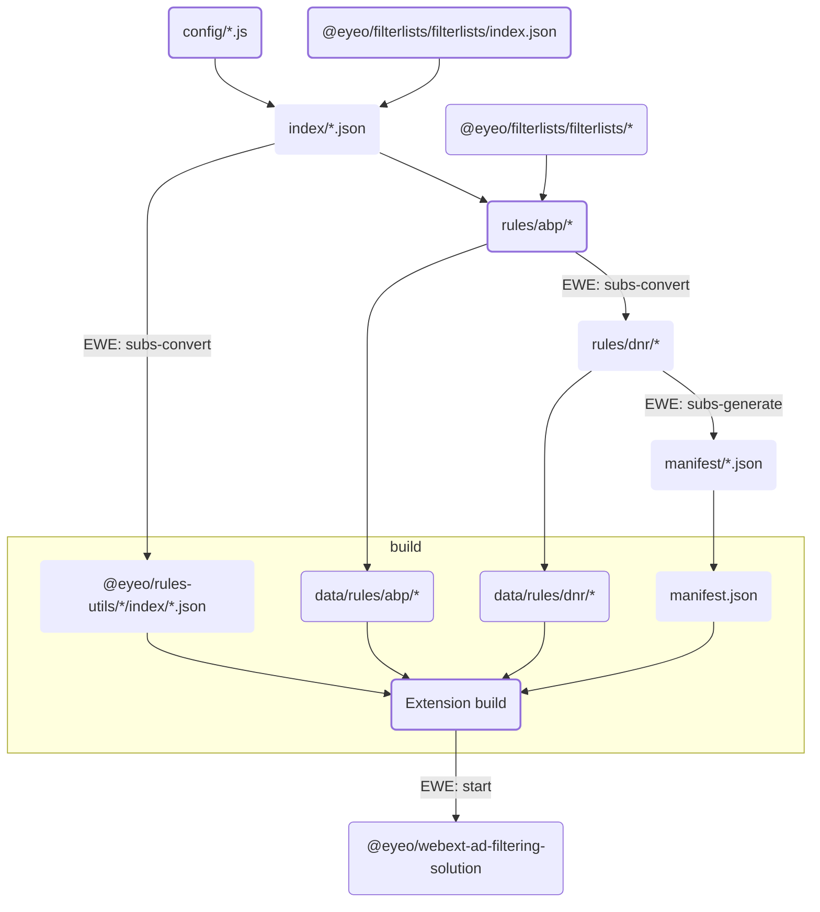

# @eyeo/rules-utils

Tools for retrieving filter lists and generating rules files from various sources for use in AdBlock and Adblock Plus.

## Integration

- Include content of `dist/{adblock|adblockplus}/manifest/{adblock|adblockplus}.json` in manifest.json file.
- Include `dist/{adblock|adblockplus}/rules/abp/*` in build as `data/rules/abp/*`.
- Include `dist/{adblock|adblockplus}/rules/dnr/*` in build as `data/rules/dnr/*`.
- Import index from `@eyeo/rules-utils/{adblock|adblockplus}/index/{adblock|adblockplus}.json` to `EWE.start()`.

  ```js
  import index from "@eyeo/rules-utils/adblock/index/adblock.json";

  EWE.start({ bundledSubscriptions: index, … });
  ```

### Rules data generation



## Testing

### Unit tests

Unit tests are contained in `src/**/*.spec.js` files.

```bash
npm test -- --scope @eyeo/rules-utils
```

### End-to-end tests

End-to-end tests are contained in `test/end-to-end/`.

```bash
npm test:end-to-end -- --scope @eyeo/rules-utils
```
